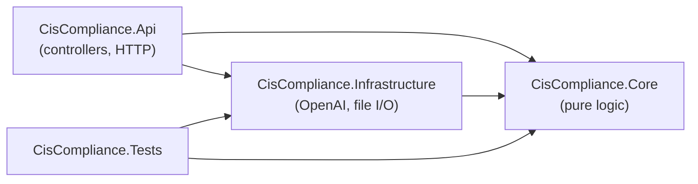
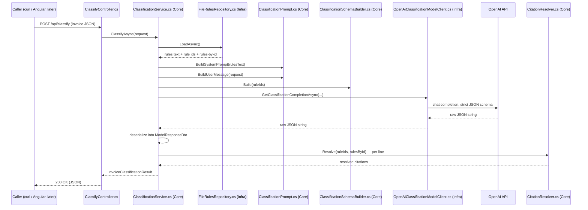

# Production Build Guide

A file-by-file walkthrough of everything created or edited since the POC wrapped up. If `CIS_POC_RESULTS.md` is "what we proved," this doc is "what we're building on top of it, and how the pieces fit together."

Written for someone who knows this project deeply but is new to .NET and Angular specifically. Where a concept needs a name before the file makes sense, it gets a short explanation the first time it comes up.

---

## 1. The big picture

The POC proved the *idea* works: an LLM can classify UK invoice line items for CIS with citation-safe, auditable reasoning, at 95.7% validated accuracy. Everything since then is turning that proof into an actual application: a C# API serving real HTTP endpoints, and an Angular front end for a human to use.

Two things are true about this phase, and worth holding in your head as you read the rest of this doc:

1. **This is a portfolio project**, not a PwC deliverable — so "production" here means "built the way a real team would build it," not "actually deployed and load-bearing for a client." That's why the architecture (layering, tests, dependency injection) is more deliberate than a weekend script would need.
2. **We're partway through.** Two things are done and verified: the project skeleton, and the actual classification logic. Two things aren't started: the Angular UI (still just a health-check placeholder page) and persistence (there's no database — a request comes in, gets classified, and the result goes straight back out, nothing is saved).

```
POC (done, validated)
   -> Production scaffold (done)
        -> Classification logic port (done)  <-- you are here
             -> Angular UI port              <-- not started
             -> Persistence / DB             <-- not started, undecided
             -> OCR (PDF -> invoice JSON)     <-- deliberately deferred
```

---

## 2. Repo layout at a glance

```
Construction Industry Scheme Project/
├── POC/                        unchanged, the validation record everything below is ported from
├── CIS_POC_BRIEF.md            unchanged
├── CIS_POC_RESULTS.md          unchanged
├── README.md                   NEW — orientation for the whole repo
├── .gitignore                  EDITED — now also covers .NET/Angular build output
└── src/
    ├── api/                    the .NET solution (this doc's main subject)
    │   ├── CisCompliance.sln
    │   ├── CisCompliance.Api/            the web server — thin, HTTP-facing
    │   ├── CisCompliance.Core/           the actual classification logic — no external dependencies
    │   ├── CisCompliance.Infrastructure/ talks to OpenAI and the filesystem
    │   └── CisCompliance.Tests/          xUnit tests for Core + Infrastructure
    └── web/                    the Angular workspace (still just a health-check page so far)
```

---

## 3. How the pieces relate

### 3.1 The dependency direction

This is the single most important thing to understand about the .NET side. Arrows point from "depends on" to "depended on":



`Core` has **zero** references to anything else in the solution, and zero NuGet packages. It doesn't know OpenAI exists, doesn't know it's being called over HTTP, doesn't know its rules come from a file on disk. It only knows about two interfaces it defines itself (`IRulesRepository`, `IClassificationModelClient`) and trusts that *something* will implement them.

`Infrastructure` is where those interfaces get implemented for real — reading actual files, calling the actual OpenAI API. `Api` wires the two together and exposes them over HTTP.

Why bother with this split for a project this size? Because it's exactly what makes the `Core` classification logic testable without a network call or an API key — see `CisCompliance.Tests`, section 3.3.

### 3.2 A request, traced end to end

This is the most useful way to see how the files actually cooperate. Here's what happens, file by file, when someone calls `POST /api/classify`:



Keep this diagram in mind while reading section 4 — every file below has a specific point on this timeline.

### 3.3 Why `CisCompliance.Tests` doesn't need a real API key

Because `ClassificationService` only depends on the two `Core` interfaces, the tests can hand it **fakes** instead of the real file-reading/OpenAI-calling implementations (`TestDoubles/FakeRulesRepository.cs`, `TestDoubles/FakeClassificationModelClient.cs`). A fake just returns canned data instantly. That's what lets `ClassificationServiceTests.cs` exercise the *whole* orchestration logic — deserializing a model response, mapping to enums, resolving citations — without a network call, an API key, or non-determinism. Only `Infrastructure`'s own code needs the real thing, and it isn't unit tested against a live API (that's what the manual `curl` verification was for).

---

## 4. File-by-file walkthrough

### 4.1 Root-level files

| File | What changed | Why |
|---|---|---|
| `README.md` | **New** | Orientation for anyone opening the repo cold: what `POC/` is, what `src/api`/`src/web` are, how to run each. |
| `.gitignore` | **Edited** | Added `src/api/**/bin/`, `src/api/**/obj/` (.NET build output) and `src/web/node_modules/`, `dist/`, `.angular/` (Angular build output/cache), so none of that gets committed. |

### 4.2 `CisCompliance.sln`

The solution file. Not really "code" — just a manifest telling `dotnet` (and any IDE) which four projects belong together and should be built as one unit. Equivalent mental model: your `POC/` folder groups `classify.py` and `generate_invoices.py` as "things belonging to this effort," except `.sln` is a format tools understand rather than just a folder convention.

### 4.3 `CisCompliance.Core` — the pure logic layer

Nothing here can import anything OpenAI-specific or filesystem-specific. If you ever see a `using OpenAI...` or `using System.IO...` in this folder, that's a sign the layering has been violated.

**`Models/`** — the data shapes, all C# `record` types (an idiomatic modern-C# choice for data-only types: immutable by default, get equality-by-value for free).

| File | What it represents |
|---|---|
| `InvoiceLineItemRequest.cs` | One line item as submitted: id, description, amount. `AmountGbp` is `decimal`, not `double` — deliberate, currency shouldn't use binary floating point. |
| `InvoiceClassificationRequest.cs` | A whole invoice submission. No ground-truth field — unlike the POC's invoice JSON files, a real request has no known answer to begin with. |
| `ClassificationLabel.cs` | Enum: `Construction` \| `Services`. |
| `ConfidenceLevel.cs` | Enum: `High` \| `Low`. Still the model's own self-report, not a calibrated score — same caveat as the POC. |
| `RuleCitation.cs` | One resolved (or unresolved) citation: rule id, whether it resolved, and the HMRC source details if it did. |
| `LineItemClassification.cs` | The classification result for one line: label, confidence, reasoning, citations. |
| `InvoiceClassificationResult.cs` | The whole response: invoice id + a list of `LineItemClassification`. |
| `RuleDefinition.cs` | One entry from `cis_rules_index.json`, typed. |
| `RulesData.cs` | What `IRulesRepository` hands back: rules text (for the prompt) + rule ids (for the schema enum) + a rule-id lookup (for citation resolution). |

**`Abstractions/`** — the interfaces `Infrastructure` implements. This is the seam that keeps `Core` dependency-free.

| File | What it's for |
|---|---|
| `IRulesRepository.cs` | "Give me the rules, however you get them." |
| `IClassificationModelClient.cs` | "Send this prompt+schema, give me back raw JSON text." Deliberately just a `string` in, `string` out — no OpenAI SDK types leak into this interface. |
| `IClassificationService.cs` | The public contract `ClassifyController` actually calls. |

**`Exceptions/`**

| File | What it's for |
|---|---|
| `ClassificationModelException.cs` | The one exception type that crosses from `Infrastructure`/`Core` up into `Api`. Both a failed OpenAI call and a malformed model response get wrapped in this, so the controller only has to catch one thing. |

**`Classification/`** — the actual ported logic. This is the heart of the port.

| File | Ported from (`classify.py`) | Notes |
|---|---|---|
| `ClassificationPrompt.cs` | `SYSTEM_PROMPT_TEMPLATE`, `build_messages()` | The system prompt is byte-for-byte identical to the Python original — this is the wording that was iteratively tuned to reach 95.7% accuracy, so it's a **port**, not a rewrite. |
| `ClassificationSchemaBuilder.cs` | `build_response_schema()` | The single most important file in this layer. Builds the JSON schema with property order `line_id, reasoning, rule_ids, confidence, label` — an order that's load-bearing, not stylistic (see the code comment, and `ClassificationSchemaBuilderTests.cs`). Uses `JsonObject` specifically because its insertion order is a documented guarantee; serializing a plain C# type would not be. |
| `CitationResolver.cs` | `resolve_citations()` | Looks a cited rule id up in the rules index; returns an unresolved citation (not a crash) if it's somehow not found. |
| `ModelResponseDto.cs` | (implicit in `call_model()`'s return shape) | Internal-only wire format for deserializing the model's raw JSON before mapping it to the public `LineItemClassification`. |
| `ClassificationService.cs` | `main()`'s per-invoice loop, minus scoring | The orchestrator: loads rules, builds the prompt/schema/message, calls the model, deserializes, resolves citations. This is what `ClassifyController` actually calls. |

### 4.4 `CisCompliance.Infrastructure` — the outside-world layer

Everything here is allowed to know about OpenAI, the filesystem, and configuration — the things `Core` isn't allowed to know about.

**`Rules/`**

| File | What it does |
|---|---|
| `RulesRepositoryOptions.cs` | Config shape: where on disk the two rules files live. |
| `RulesIndexFileDto.cs` | Matches `cis_rules_index.json`'s raw snake_case shape, internal-only — mapped into `Core`'s `RuleDefinition` immediately after reading. |
| `FileRulesRepository.cs` | Implements `IRulesRepository`. Reads `cis_rules.md` + `cis_rules_index.json` from disk once, memoizes the result (same "load once per process" behaviour as `classify.py`'s `load_rules()`). |

**`OpenAi/`**

| File | What it does |
|---|---|
| `OpenAiOptions.cs` | Config shape: API key (never defaulted — a blank key must fail loudly, not silently) and model name (defaults to `gpt-4o-mini`, matching the validated POC model). |
| `OpenAiClassificationModelClient.cs` | Implements `IClassificationModelClient`. The **only** file in the whole solution that references the OpenAI SDK's types (`ChatClient`, `BinaryData`, etc.) — everything else talks through the plain-string interface. |

**`InfrastructureServiceCollectionExtensions.cs`** — the single entry point `Program.cs` calls to wire up everything in this project (the `ChatClient`, the two interface implementations, configuration binding). This is dependency injection registration — think of it as "here's the phone book Program.cs consults so it never has to `new` these things up by hand."

### 4.5 `CisCompliance.Api` — the thin HTTP layer

| File | What changed | What it does |
|---|---|---|
| `Program.cs` | **Edited** | The entry point. Registers controllers, Swagger, CORS (unchanged from scaffold), and now also calls `AddCisComplianceInfrastructure(...)` and registers `IClassificationService`. Two lines added to a file that otherwise didn't need to change. |
| `Controllers/HealthController.cs` | Unchanged (scaffold) | `GET /api/health` — the original proof-of-life endpoint, still there. |
| `Controllers/ClassifyController.cs` | **New** | `POST /api/classify` — validates the request has line items, calls `IClassificationService`, and maps a `ClassificationModelException` to a `502` response instead of an unhandled crash. |
| `appsettings.json` | **Edited** | Added `OpenAI:Model` and `Rules:*` paths. Deliberately does **not** contain `OpenAI:ApiKey` — that only ever lives in user secrets (local dev) or an environment variable, never in a committed file. |
| `CisCompliance.Api.csproj` | **Edited** | Added a `UserSecretsId` (added by running `dotnet user-secrets init`, not hand-typed) and marked the two `Data/*` files as copy-to-output content. |
| `Data/cis_rules.md`, `Data/cis_rules_index.json` | **New** | Byte-for-byte copies of the POC's rules files. `POC/` itself is untouched — these are copies the API reads at runtime, not a move. |

### 4.6 `CisCompliance.Tests`

| File | What it tests |
|---|---|
| `TestDoubles/FakeRulesRepository.cs`, `FakeClassificationModelClient.cs` | Canned-data stand-ins for the two `Core` interfaces, used by every test below. |
| `Classification/CitationResolverTests.cs` | A known rule id resolves with full source details; an unknown one (the same "fake `R99`" scenario the POC's `--dry-run` mode deliberately exercised) resolves as `Resolved: false` without throwing. |
| `Classification/ClassificationSchemaBuilderTests.cs` | **The most important test in the solution.** Parses the built schema with `JsonDocument` (which preserves source order) and asserts the property order is exactly `line_id, reasoning, rule_ids, confidence, label`. If someone reorders those fields later without realizing why it matters, this test catches it. |
| `Classification/ClassificationServiceTests.cs` | End-to-end through the fakes: an unresolvable citation survives the whole pipeline without throwing; a model response missing a requested line item throws `ClassificationModelException` (fail loud, since there's no ground truth to fall back on in production); label/confidence strings map to the right enums. |

### 4.7 `src/web` — the Angular workspace

Still just the health-check proof-of-life from the scaffold phase — nothing here has been touched by the classification port. Listed for completeness, since it's still part of "what exists after the POC":

| File | What changed | What it does |
|---|---|---|
| `src/app/app.routes.ts` | **Edited** | One route, `''`, pointing at `HealthComponent`. |
| `src/app/app.config.ts` | **Edited** | Added `provideHttpClient()` so components can make HTTP calls. |
| `src/app/app.html` | **Edited** | Stripped down to just `<router-outlet />` (was the Angular CLI's default marketing template). |
| `src/app/core/config/app-config.ts` | **New** | Hardcoded `API_BASE_URL` pointing at the API's dev URL. Will need to become a proper environment-config setup once there's more than one endpoint to call. |
| `src/app/features/health/health.component.ts` + `.html` | **New** | Calls `GET /api/health` on load and displays the result — proves CORS and the two dev servers can talk to each other. This whole `features/health/` folder is a placeholder; it'll be replaced by real feature folders (`dashboard/`, `invoices/`, `detail/`, `upload/`) when the mockup gets ported. |

---

## 5. Where this leaves us

Every file above exists to answer one of two questions:

- **"Can the skeleton run end to end?"** — answered by the scaffold (Program.cs wiring, the health check, CORS).
- **"Does the skeleton actually do the real classification work, faithfully?"** — answered by everything in section 4.3/4.4/4.6, and confirmed by a live call reproducing the POC's exact (known) behaviour, including its one documented non-determinism case.

What's conspicuously **not** represented by any file yet:
- A real UI beyond the health check (the mockup's 4 views still live only in `POC/Mock Up/`, not in `src/web`)
- Any persistence — nothing submitted to `/api/classify` is saved anywhere
- OCR — there's no path from a PDF to the JSON shape `ClassifyController` expects

Those three are the next chapters, in roughly that order of priority, per the earlier discussion.
