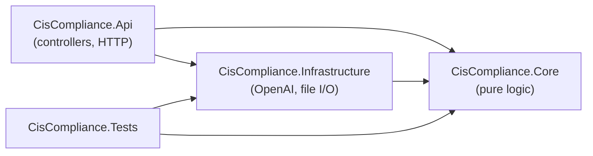
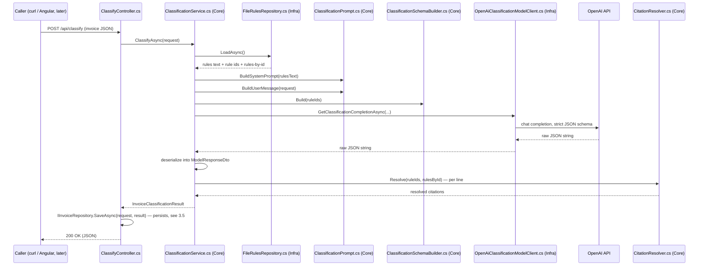
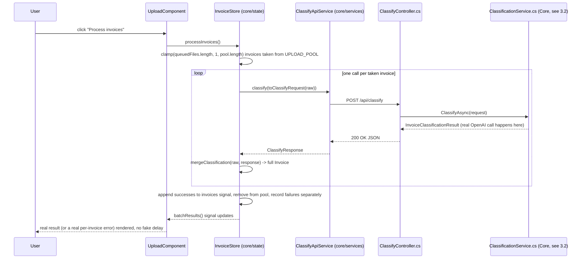
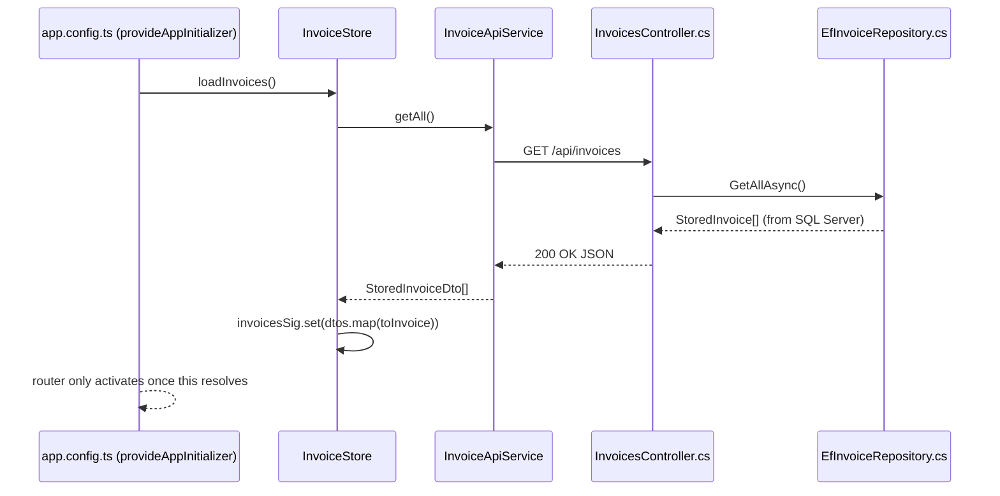
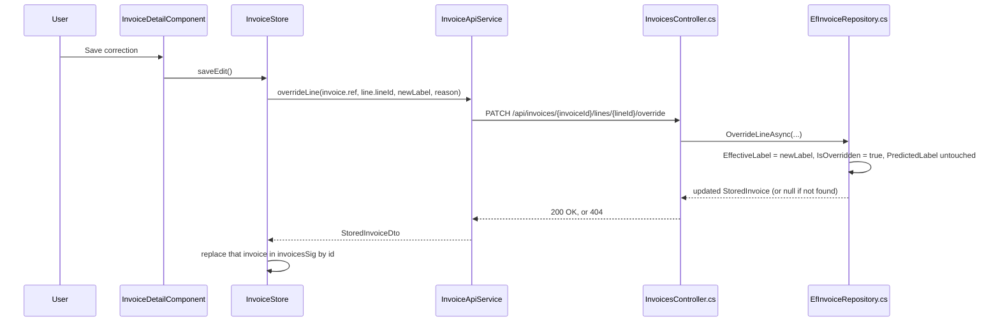

# Production Build Guide

A file-by-file walkthrough of everything created or edited since the POC wrapped up. If `CIS_POC_RESULTS.md` is "what we proved," this doc is "what we're building on top of it, and how the pieces fit together."

Written for someone who knows this project deeply but is new to .NET and Angular specifically. Where a concept needs a name before the file makes sense, it gets a short explanation the first time it comes up.

---

## 1. The big picture

The POC proved the *idea* works: an LLM can classify UK invoice line items for CIS with citation-safe, auditable reasoning, at 95.7% validated accuracy. Everything since then is turning that proof into an actual application: a C# API serving real HTTP endpoints, and an Angular front end for a human to use.

Two things are true about this phase, and worth holding in your head as you read the rest of this doc:

1. **This is a portfolio project**, not a PwC deliverable — so "production" here means "built the way a real team would build it," not "actually deployed and load-bearing for a client." That's why the architecture (layering, tests, dependency injection, real routing, a real database) is more deliberate than a weekend script would need.
2. **We're partway through.** Four things are done and verified: the project skeleton, the actual classification logic, the Angular UI, and now persistence. One thing isn't started: OCR.

```
POC (done, validated)
   -> Production scaffold (done)
        -> Classification logic port (done)
             -> Angular UI port (done)
                  -> Persistence / DB (done)  <-- you are here
                       -> OCR (PDF -> invoice JSON)     <-- deliberately deferred
```

Persistence uses **SQL Server (Express edition)** via EF Core — a stakeholder-confirmed requirement (see the memory of Mark's answers to the project's open questions), not just a default. Two other requirements landed "for free" because the design already happened to satisfy them once they were confirmed: reasoning is stored permanently and retrievable (Mark's Q4), and classification stays strictly line-item level with no invoice-level rollup field (Mark's Q5).

One design decision worth understanding up front, since it shapes a lot of the file list in section 4.7: Dashboard/Grid/Detail now load from `GET /api/invoices` instead of a static TS file — the old `seed-invoices.ts` is gone, its content ported into a C#-side database seeder instead. The **Upload flow was already genuinely live** before persistence existed (a real `POST /api/classify` call, not a simulation) — persistence didn't change that, it just means an uploaded invoice (and any manual override) now survives a page reload instead of vanishing. Section 3.4 traces the live Upload call; section 3.5 traces the override/persistence flow.

---

## 2. Repo layout at a glance

```
Construction Industry Scheme Project/
├── POC/                        unchanged, the validation record everything below is ported from
├── CIS_POC_BRIEF.md            unchanged
├── CIS_POC_RESULTS.md          unchanged
├── README.md                   NEW — orientation for the whole repo
├── .gitignore                  EDITED — now also covers .NET/Angular build output
└── src/
    ├── api/                    the .NET solution (this doc's main subject)
    │   ├── CisCompliance.sln
    │   ├── CisCompliance.Api/            the web server — thin, HTTP-facing
    │   ├── CisCompliance.Core/           the actual classification logic — no external dependencies
    │   ├── CisCompliance.Infrastructure/ talks to OpenAI, the filesystem, and now the database
    │   └── CisCompliance.Tests/          xUnit tests for Core + Infrastructure
    └── web/                    the Angular workspace — Dashboard, Grid, Detail, Upload, all live
```

---

## 3. How the pieces relate

### 3.1 The dependency direction

This is the single most important thing to understand about the .NET side. Arrows point from "depends on" to "depended on":



`Core` has **zero** references to anything else in the solution, and zero NuGet packages. It doesn't know OpenAI exists, doesn't know it's being called over HTTP, doesn't know its rules come from a file on disk. It only knows about two interfaces it defines itself (`IRulesRepository`, `IClassificationModelClient`) and trusts that *something* will implement them.

`Infrastructure` is where those interfaces get implemented for real — reading actual files, calling the actual OpenAI API. `Api` wires the two together and exposes them over HTTP.

Why bother with this split for a project this size? Because it's exactly what makes the `Core` classification logic testable without a network call or an API key — see `CisCompliance.Tests`, section 3.3.

### 3.2 A request, traced end to end

This is the most useful way to see how the files actually cooperate. Here's what happens, file by file, when someone calls `POST /api/classify`:



Keep this diagram in mind while reading section 4 — every file below has a specific point on this timeline. The `SaveAsync` step is new since persistence landed: the response contract itself didn't change, it's a pure side effect inserted between getting the result and returning it.

### 3.3 Why `CisCompliance.Tests` doesn't need a real API key

Because `ClassificationService` only depends on the two `Core` interfaces, the tests can hand it **fakes** instead of the real file-reading/OpenAI-calling implementations (`TestDoubles/FakeRulesRepository.cs`, `TestDoubles/FakeClassificationModelClient.cs`). A fake just returns canned data instantly. That's what lets `ClassificationServiceTests.cs` exercise the *whole* orchestration logic — deserializing a model response, mapping to enums, resolving citations — without a network call, an API key, or non-determinism. Only `Infrastructure`'s own code needs the real thing, and it isn't unit tested against a live API (that's what the manual `curl` verification was for).

### 3.4 The Upload flow, traced end to end

This is the one place the Angular app and the C# API genuinely talk to each other over HTTP (everywhere else in the UI reads from in-memory seed data). Worth tracing in full, because it's the proof that the whole stack — Angular signals, HTTP, ASP.NET Core, the classification logic from section 3.2, and back — actually works together, not just in isolation:



The `UPLOAD_POOL` (`core/data/upload-pool.ts`) holds 2 real, not-yet-classified POC invoices — the same ones (`INV-2026-0009`, `INV-2026-0010`) used for this exact purpose in the original HTML mockup. Each `classify()` call is wrapped in its own error handler, so if one invoice's OpenAI call fails, the rest of the batch still succeeds — a failed invoice just stays in the pool for a retry on the next click, rather than losing the whole batch.

### 3.5 The override flow, and how the app boots with real data

Two things changed with persistence: where the initial invoice list comes from, and what happens when someone corrects a classification.

**On app start**, before the router shows anything:



This is why `invoiceExistsGuard` (section 4.7) never needed to become async itself: `provideAppInitializer` guarantees the store is already populated (or has failed and is deliberately empty) before any route or guard runs. If `loadInvoices()` fails, it catches its own error and resolves to an empty list rather than rejecting — a down API boots an empty-but-usable app, not a permanently blank screen.

**Overriding a line** (Detail view, "Override classification" → "Save correction"):



The audit-trail point worth sitting with: `PredictedLabel` is written once, at classify time, and `OverrideLineAsync` never touches it — only `EffectiveLabel` moves. A reviewer opening the database directly (see `Persistence/demo_audit_trail.sql`) can see both the AI's original answer and a human's correction side by side, which is the entire reason this schema has two label columns instead of one.

---

## 4. File-by-file walkthrough

### 4.1 Root-level files

| File | What changed | Why |
|---|---|---|
| `README.md` | **New** | Orientation for anyone opening the repo cold: what `POC/` is, what `src/api`/`src/web` are, how to run each. |
| `.gitignore` | **Edited** | Added `src/api/**/bin/`, `src/api/**/obj/` (.NET build output) and `src/web/node_modules/`, `dist/`, `.angular/` (Angular build output/cache), so none of that gets committed. |

### 4.2 `CisCompliance.sln`

The solution file. Not really "code" — just a manifest telling `dotnet` (and any IDE) which four projects belong together and should be built as one unit. Equivalent mental model: your `POC/` folder groups `classify.py` and `generate_invoices.py` as "things belonging to this effort," except `.sln` is a format tools understand rather than just a folder convention.

### 4.3 `CisCompliance.Core` — the pure logic layer

Nothing here can import anything OpenAI-specific or filesystem-specific. If you ever see a `using OpenAI...` or `using System.IO...` in this folder, that's a sign the layering has been violated.

**`Models/`** — the data shapes, all C# `record` types (an idiomatic modern-C# choice for data-only types: immutable by default, get equality-by-value for free).

| File | What it represents |
|---|---|
| `InvoiceLineItemRequest.cs` | One line item as submitted: id, description, amount. `AmountGbp` is `decimal`, not `double` — deliberate, currency shouldn't use binary floating point. |
| `InvoiceClassificationRequest.cs` | A whole invoice submission. No ground-truth field — unlike the POC's invoice JSON files, a real request has no known answer to begin with. |
| `ClassificationLabel.cs` | Enum: `Construction` \| `Services`. |
| `ConfidenceLevel.cs` | Enum: `High` \| `Low`. Still the model's own self-report, not a calibrated score — same caveat as the POC. |
| `RuleCitation.cs` | One resolved (or unresolved) citation: rule id, whether it resolved, and the HMRC source details if it did. |
| `LineItemClassification.cs` | The classification result for one line: label, confidence, reasoning, citations. |
| `InvoiceClassificationResult.cs` | The whole response: invoice id + a list of `LineItemClassification`. |
| `RuleDefinition.cs` | One entry from `cis_rules_index.json`, typed. |
| `RulesData.cs` | What `IRulesRepository` hands back: rules text (for the prompt) + rule ids (for the schema enum) + a rule-id lookup (for citation resolution). |
| `StoredInvoice.cs` | The full, persisted shape `GET /api/invoices` returns — everything `InvoiceClassificationResult` has, plus `Description`/`AmountGbp` per line (the classify response never carried those, the client already had them) and the audit fields below. |
| `StoredLineItemClassification.cs` | One persisted line: `PredictedLabel`/`PredictedConfidence` (written once, never touched again — the AI's original answer) alongside `EffectiveLabel`/`IsOverridden`/`OverrideReason`/`OverriddenAtUtc` (what's actually in force, which may differ if a human corrected it). |
| `OverrideLineRequest.cs` | The override endpoint's request body: `NewLabel` + `Reason`. |

**`Abstractions/`** — the interfaces `Infrastructure` implements. This is the seam that keeps `Core` dependency-free.

| File | What it's for |
|---|---|
| `IRulesRepository.cs` | "Give me the rules, however you get them." |
| `IClassificationModelClient.cs` | "Send this prompt+schema, give me back raw JSON text." Deliberately just a `string` in, `string` out — no OpenAI SDK types leak into this interface. |
| `IClassificationService.cs` | The public contract `ClassifyController` actually calls. |
| `IInvoiceRepository.cs` | `SaveAsync`, `GetAllAsync`, `GetByIdAsync`, `OverrideLineAsync`. The two lookup methods return `null` (not an exception) when nothing matches, so `Core` stays free of any HTTP-status concept — `InvoicesController` is what turns a `null` into a 404. |

**`Exceptions/`**

| File | What it's for |
|---|---|
| `ClassificationModelException.cs` | The one exception type that crosses from `Infrastructure`/`Core` up into `Api`. Both a failed OpenAI call and a malformed model response get wrapped in this, so the controller only has to catch one thing. |

**`Classification/`** — the actual ported logic. This is the heart of the port.

| File | Ported from (`classify.py`) | Notes |
|---|---|---|
| `ClassificationPrompt.cs` | `SYSTEM_PROMPT_TEMPLATE`, `build_messages()` | The system prompt is byte-for-byte identical to the Python original — this is the wording that was iteratively tuned to reach 95.7% accuracy, so it's a **port**, not a rewrite. |
| `ClassificationSchemaBuilder.cs` | `build_response_schema()` | The single most important file in this layer. Builds the JSON schema with property order `line_id, reasoning, rule_ids, confidence, label` — an order that's load-bearing, not stylistic (see the code comment, and `ClassificationSchemaBuilderTests.cs`). Uses `JsonObject` specifically because its insertion order is a documented guarantee; serializing a plain C# type would not be. |
| `CitationResolver.cs` | `resolve_citations()` | Looks a cited rule id up in the rules index; returns an unresolved citation (not a crash) if it's somehow not found. |
| `ModelResponseDto.cs` | (implicit in `call_model()`'s return shape) | Internal-only wire format for deserializing the model's raw JSON before mapping it to the public `LineItemClassification`. |
| `ClassificationService.cs` | `main()`'s per-invoice loop, minus scoring | The orchestrator: loads rules, builds the prompt/schema/message, calls the model, deserializes, resolves citations. This is what `ClassifyController` actually calls. |

### 4.4 `CisCompliance.Infrastructure` — the outside-world layer

Everything here is allowed to know about OpenAI, the filesystem, and configuration — the things `Core` isn't allowed to know about.

**`Rules/`**

| File | What it does |
|---|---|
| `RulesRepositoryOptions.cs` | Config shape: where on disk the two rules files live. |
| `RulesIndexFileDto.cs` | Matches `cis_rules_index.json`'s raw snake_case shape, internal-only — mapped into `Core`'s `RuleDefinition` immediately after reading. |
| `FileRulesRepository.cs` | Implements `IRulesRepository`. Reads `cis_rules.md` + `cis_rules_index.json` from disk once, memoizes the result (same "load once per process" behaviour as `classify.py`'s `load_rules()`). |

**`OpenAi/`**

| File | What it does |
|---|---|
| `OpenAiOptions.cs` | Config shape: API key (never defaulted — a blank key must fail loudly, not silently) and model name (defaults to `gpt-4o-mini`, matching the validated POC model). |
| `OpenAiClassificationModelClient.cs` | Implements `IClassificationModelClient`. The **only** file in the whole solution that references the OpenAI SDK's types (`ChatClient`, `BinaryData`, etc.) — everything else talks through the plain-string interface. |

**`Persistence/`**

| File | What it does |
|---|---|
| `CisComplianceDbContext.cs` | The EF Core `DbContext`, one `DbSet<InvoiceEntity>`. Configures `ClassificationLabel`/`ConfidenceLevel` to store as readable text (`HasConversion<string>()`) rather than raw ints — a compliance tool a reviewer might open directly in SQL, worth the column being self-explanatory. Citations are an **owned type collection** on the line entity (no independent identity of their own, always loaded/saved with their parent line) rather than a separately-queried table. |
| `Entities/InvoiceEntity.cs`, `InvoiceLineEntity.cs`, `RuleCitationEntity.cs` | The three-table schema: an invoice (keyed by its own id, e.g. `"INV-2026-0001"`, no separate surrogate key), its line items (their own table, since the override endpoint needs to address one directly by `LineId`), and each line's citations (owned, no table of their own). |
| `EfInvoiceRepository.cs` | Implements `IInvoiceRepository`. `SaveAsync` is **upsert-by-replace** — re-classifying an already-saved invoice deletes its old lines and rebuilds fresh ones, which means it also discards any prior override on that invoice. This is a documented, tested trade-off (see `EfInvoiceRepositoryTests.cs`), not an oversight: nothing in the current UI actually re-classifies an already-saved invoice, so it's a real edge case with no live path to hit it yet. |
| `InvoiceSeedData.cs`, `CisComplianceDbSeeder.cs` | The same 8 real POC invoices that used to live in Angular's (now-deleted) `seed-invoices.ts`, ported here as plain rule-id lists. The seeder resolves those ids against the real `cis_rules_index.json` via `CitationResolver.Resolve()` — the exact same code path a live classification uses — so seed citations carry real source data instead of hand-copied strings that could drift out of sync. Runs once at startup, only if the `Invoices` table is empty, and never calls the OpenAI client, so a fresh checkout is fully populated with zero API key required for anything except the live Upload flow. |

**`InfrastructureServiceCollectionExtensions.cs`** — the single entry point `Program.cs` calls to wire up everything in this project (the `ChatClient`, the two interface implementations, configuration binding, and now `AddDbContext<CisComplianceDbContext>` + `IInvoiceRepository`). This is dependency injection registration — think of it as "here's the phone book Program.cs consults so it never has to `new` these things up by hand." The connection string is read from `ConnectionStrings:CisComplianceDb` and throws at startup if it's missing, same fail-fast philosophy as the OpenAI key check.

### 4.5 `CisCompliance.Api` — the thin HTTP layer

| File | What changed | What it does |
|---|---|---|
| `Program.cs` | **Edited** | The entry point. Registers controllers, Swagger, CORS (unchanged from scaffold), calls `AddCisComplianceInfrastructure(...)`, registers `IClassificationService`, and — since persistence — applies any pending EF Core migrations and runs the seeder once at startup, before the app starts accepting requests. `dotnet run` on a fresh checkout is enough, no manual migration step. |
| `Controllers/HealthController.cs` | Unchanged (scaffold) | `GET /api/health` — the original proof-of-life endpoint, still there. |
| `Controllers/ClassifyController.cs` | **Edited** | `POST /api/classify` — validates the request has line items, calls `IClassificationService`, and (new) calls `IInvoiceRepository.SaveAsync(...)` before returning, persisting the result as a side effect. No try/catch around that call: a save failure surfaces as an unhandled 500 rather than silently losing a result the real OpenAI call already paid for. Still maps `ClassificationModelException` to `502` as before. |
| `Controllers/InvoicesController.cs` | **New** | `GET /api/invoices` (list), `GET /api/invoices/{id}` (single, 404 if unknown), `PATCH /api/invoices/{invoiceId}/lines/{lineId}/override` (400 if the reason is blank, 404 if the invoice/line doesn't exist, otherwise returns the whole updated invoice). |
| `appsettings.json` | **Edited** | Added `OpenAI:Model`, `Rules:*` paths, and now `ConnectionStrings:CisComplianceDb`. The connection string is safe to commit — it uses Windows trusted auth (`Trusted_Connection=True`), no password in it — unlike `OpenAI:ApiKey`, which still only ever lives in user secrets or an environment variable, never in a committed file. |
| `CisCompliance.Api.csproj` | **Edited** | `UserSecretsId` (from the scaffold phase), the two `Data/*` files as copy-to-output content, and now `Microsoft.EntityFrameworkCore.Design` — needed for the `dotnet ef migrations` tooling to work from this project (the "startup project" in EF Core's terms), even though the `DbContext` itself lives in `Infrastructure`. |
| `Data/cis_rules.md`, `Data/cis_rules_index.json` | **New** (scaffold-era) | Byte-for-byte copies of the POC's rules files. `POC/` itself is untouched — these are copies the API reads at runtime, not a move. |

### 4.6 `CisCompliance.Tests`

| File | What it tests |
|---|---|
| `TestDoubles/FakeRulesRepository.cs`, `FakeClassificationModelClient.cs` | Canned-data stand-ins for the two `Core` interfaces, used by every test below. |
| `Classification/CitationResolverTests.cs` | A known rule id resolves with full source details; an unknown one (the same "fake `R99`" scenario the POC's `--dry-run` mode deliberately exercised) resolves as `Resolved: false` without throwing. |
| `Classification/ClassificationSchemaBuilderTests.cs` | **The most important test in the solution.** Parses the built schema with `JsonDocument` (which preserves source order) and asserts the property order is exactly `line_id, reasoning, rule_ids, confidence, label`. If someone reorders those fields later without realizing why it matters, this test catches it. |
| `Classification/ClassificationServiceTests.cs` | End-to-end through the fakes: an unresolvable citation survives the whole pipeline without throwing; a model response missing a requested line item throws `ClassificationModelException` (fail loud, since there's no ground truth to fall back on in production); label/confidence strings map to the right enums. |
| `Persistence/EfInvoiceRepositoryTests.cs` | Uses EF Core's **InMemory** provider (a fresh `Guid`-named database per test) — no real SQL Server touched, same "no real network/file/DB dependency in any test" property the rest of the suite already had. Covers save-then-get round trips, unknown-id lookups returning `null`, and — the one that actually matters — that overriding a line changes `EffectiveLabel` while `PredictedLabel` still shows the original AI answer. That single assertion is the audit-trail guarantee this whole feature exists for. |

### 4.7 `src/web` — the Angular workspace

The scaffold phase's health-check placeholder is gone (`features/health/` was deleted once it had served its purpose — its only job, proving the API is reachable, is now subsumed by the real Upload flow). What's here now is the full 4-view app: Dashboard, Grid, Detail, Upload, all standalone components using Angular signals for state, ported from `POC/Mock Up/CIS Invoice Compliance Tool/CIS Compliance Tool-standalone.html` — treated as a precise behavioral spec, not something eyeballed and approximated. Three small, deliberate bug fixes were made along the way rather than silently reproduced: the mockup's "Reference" grid column never actually sorted anything (dead code) — fixed; the monthly trend chart's bar-height formula scaled against the wrong constant, under-filling its own container — fixed; a detail-view URL for an unknown invoice id blanked the page — fixed with a route guard that redirects to the grid instead.

Since persistence landed, the app no longer has any hardcoded invoice data at all — everything shown anywhere in the UI came from a real `GET` call at some point. `seed-invoices.ts` is gone; see section 3.5 for how the app boots with real data instead.

**`core/models/`** — TypeScript shapes, no logic.

| File | What it represents |
|---|---|
| `invoice.model.ts` | `Invoice`/`InvoiceLine`, the display-ready shape every view reads from. `InvoiceLine` gained a `lineId` field once persistence landed — lines used to be addressable only by array index, but the override endpoint needs a stable id to target one line directly. |
| `classify-api.model.ts` | Mirrors `CisCompliance.Core.Models` (`ClassifyRequest`/`ClassifyResponse`/`RuleCitationDto`/etc.) property for property, camelCase. Keeping this a direct mirror means a backend contract drift is a TypeScript compile error here, not a silent runtime mismatch — same defensive idea as the C# side's `ModelResponseDto`. |
| `unclassified-invoice.model.ts` | The "not yet processed" shape used by the upload pool — real line items, no classification/confidence/citation/reasoning yet, since that only exists once the real API has answered. |
| `stored-invoice.model.ts` | Mirrors `StoredInvoice`/`StoredLineItemClassification` from Core — reuses `ApiLabel`/`ApiConfidence`/`RuleCitationDto` from `classify-api.model.ts` where the shapes genuinely match, only adds what's new (`predictedLabel` vs `effectiveLabel`, `isOverridden`, etc.). |

**`core/data/`** — static fixtures, real data, not invented.

| File | What it holds |
|---|---|
| ~~`seed-invoices.ts`~~ | **Deleted** once persistence landed. Its 8 invoices (from the mockup's `RAW_INVOICES`) now live in `CisCompliance.Infrastructure/Persistence/InvoiceSeedData.cs` instead, seeded into the database at startup — see section 4.4. Dashboard/Grid/Detail get that same data via `GET /api/invoices` now, not a static import. |
| `upload-pool.ts` | The 2 real, not-yet-classified invoices from `POC/data/invoices/INV-2026-0009.json` and `INV-2026-0010.json` (stripped of their POC-only `_ground_truth` blocks). This is what Upload actually sends to the live API — unaffected by the persistence work, still lives client-side since it represents "not yet processed," not a business record. |

**`core/services/` and `core/utils/`** — the logic layer, deliberately framework-light so it's easy to unit test later.

| File | What it does |
|---|---|
| `classify-api.service.ts` | Thin `HttpClient` wrapper around `POST /api/classify`. No error handling here on purpose — that's a state concern, handled by whoever calls it. |
| `invoice-api.service.ts` | The persistence-era counterpart: `getAll()` (`GET /api/invoices`) and `overrideLine()` (the `PATCH` endpoint). Kept as a separate service from `classify-api.service.ts` rather than merged in — that one's scoped specifically to the live-classify call, this one covers reading and correcting already-persisted data, a different concern. |
| `invoice-calculations.ts` | `computeInvoice()` — a direct port of the mockup's status-derivation logic (see the box below), plus `buildDashboardAggregates()` (the hero stat, the monthly trend bars, the "needs review" table) and `buildGridRows()` (search + status filter + sort, applied in that order). All pure functions, no Angular dependency, so they don't need a running app to test. |
| `classification-mapper.ts` | `toClassifyRequest()` (pool invoice → API request), `mergeClassification()` (API response, merged back onto the original request's line items by `lineId`, since the response itself doesn't echo back description/amount — now also copies `lineId` onto the resulting line, not cosmetic, it's what lets a just-uploaded invoice be overridden before any refetch), `joinCitations()` (turns resolved citations into one display string, e.g. `"R10 (CIS340), R12 (POC-METHOD)"`), `extractErrorMessage()` (reads the RFC7807 `detail`/`title` off a failed response). |
| `stored-invoice-mapper.ts` | `toInvoice()` — maps a `StoredInvoiceDto` (from `GET /api/invoices`) into the same `Invoice` shape the rest of the app already uses, mirroring `mergeClassification`'s id/ref-lowercasing convention exactly so a DB-loaded invoice and a freshly-live-classified one look identical to every component. Reuses `joinCitations()` from `classification-mapper.ts` rather than duplicating it. |

> **`computeInvoice()` status logic**, ported exactly from the mockup: an invoice's status is `Reviewed` if *any* line has been manually overridden (this short-circuits everything else), else `Flagged` if 2+ lines are low-confidence, else `Needs review` if exactly 1 is, else `Reviewed`. Separately, the "AI confidence" badge (`confidenceSummary`) is computed purely from the low-confidence count, independent of status or overrides — so an invoice can legitimately show status `Reviewed` (because someone corrected a line) while its confidence badge still reads `"1 flagged"` (because the correction didn't touch the low-confidence line). That disagreement is real, ported faithfully, not a bug.

**`core/state/invoice-store.ts`** — the one piece of shared state the whole app reads from, `@Injectable({ providedIn: 'root' })`. Holds the invoice list, the upload pool/queue/processing state, and search/filter/sort/editing UI state as private `signal()`s, exposed as `computed()`/`.asReadonly()`. This is the direct Angular-signals equivalent of the mockup's "flat state object, derived values recomputed fresh every render" pattern. Since persistence, `invoicesSig` starts empty and is populated by `loadInvoices()` (called once from `app.config.ts`, see section 3.5) rather than a static import, and `saveEdit()` is now a real `PATCH` call instead of a local-only mutation — with `saving`/`saveError` signals so the Detail view can show a real in-flight/failure state. `processInvoices()` is still the other method that does real async work — see section 3.4 for its full trace.

**`core/guards/invoice-exists.guard.ts`** — a functional `CanActivateFn` that checks a `/invoices/:id` route's id against the store before letting the route activate, redirecting to `/invoices` if it doesn't resolve. This is the fix for the mockup's blank-page-on-unknown-id edge case, moved to the routing layer rather than handled inside the component. Its synchronous check still holds even though invoice data now comes from an async fetch — see section 3.5, `provideAppInitializer` guarantees the store is already loaded before this guard, or any route, ever runs.

**`shared/pipes/`** — small, reusable display formatting, used across every view.

| File | What it does |
|---|---|
| `gbp-currency.pipe.ts` (`\| gbp`) | `£1,968` style — rounds to the nearest pound, thousands separator. Replaces the mockup's manual `fmt()` string pre-formatting; numbers stay typed in the store, formatting happens at the template edge instead. |
| `uk-date.pipe.ts` (`\| ukDate`) | `30 Jul 2026` style, same idea as above for dates. |

**`features/`** — the 4 routed views, each a standalone component, lazy-loaded via `loadComponent` in `app.routes.ts`.

| Component | Reads from the store | Notable behavior |
|---|---|---|
| `dashboard/` | `dashboardAggregates()` | Hero %-construction stat with a conic-gradient donut, 3 metric cards, a monthly stacked bar chart, an estimated CIS-deduction card, and a "needs review" table (first 4 non-Reviewed invoices). No local state of its own. |
| `invoice-grid/` | `gridRows()`, `search()`, `statusFilter()`, `sortKey()`/`sortDir()` | Live search-as-you-type (no debounce, matching the mockup), a segmented status filter, sortable columns — including a working `ref` sort, the mockup's version of this was dead code. |
| `invoice-detail/` | `computedInvoices()`, filtered to the routed `:id` | Reads the id via a signal input (`input.required<string>()`), bound automatically by the router's `withComponentInputBinding()`. Renders the override/edit form inline; only one line app-wide can be mid-edit at once, enforced structurally by the store's single `editing` signal, not by convention. Resets any stale edit state on `ngOnDestroy` so leaving mid-edit never bleeds into the next invoice viewed. Since persistence, "Save correction" is a real network call — the Save button shows `Saving…` and disables while in flight, and a failed save surfaces an inline error message rather than pretending it worked. |
| `upload/` | `queuedFiles()`, `processing()`, `processDisabled()`, `processLabel()`, `batchResults()` | The file picker is cosmetic (captures file *names* only, exactly like the mockup — no real file content is read, that's future OCR work). "Process invoices" triggers the real live call traced in section 3.4. |

**Shell and routing**

| File | What changed | What it does |
|---|---|---|
| `app.routes.ts` | **Edited** | Real routes now: `/dashboard`, `/invoices`, `/invoices/:id` (guarded), `/upload`, plus a catch-all redirect. The mockup had no URL state at all (a single `state.view` field), so this is a deliberate improvement, not a preservation of existing behavior — there was nothing to preserve. |
| `app.config.ts` | **Edited** | Added `withComponentInputBinding()` to `provideRouter(...)` so `InvoiceDetailComponent` can receive its `:id` route param directly as a signal input. Since persistence, also adds `provideAppInitializer(...)`, which awaits `InvoiceStore.loadInvoices()` once before the router activates any route at all — see section 3.5 for why this specific approach (over a per-route resolver) was chosen. |
| `app.html` / `app.ts` / `app.css` | **Edited** | Gained the persistent nav bar (brand + Upload/All-invoices links) that every one of the mockup's 4 views shared — this belongs at the shell level, not duplicated into each feature component. |
| `app.spec.ts` | **Edited** | The Angular CLI's default test asserted on marketing-template text that no longer existed (stale since the scaffold phase, unrelated to this port) — fixed to check the real nav brand renders instead, while this file was already being touched. |
| `styles.css` | **Edited** | `@import`s `styles/industry.css` as its first line (required — `@import` must precede other rules), carries over the mockup's few genuinely-global rules (body margin, link colors, the `.icn` mask-image helper), and adds one small deliberate token: `--color-danger`/`.tag-danger`, since none of `industry.css`'s 4 existing tag variants fit an upload-failure state. |
| `styles/industry.css` | **New** | Byte-for-byte copy of the mockup's design system (CSS custom properties, the `.card`/`.tag`/`.btn`/`.table`/`.seg` component classes, the "blueprint" aesthetic with corner crosshair marks). Left untouched as a vendored file — new tokens go in `styles.css` instead, so a future re-sync with the mockup's CSS stays a clean diff. |

---

## 5. Where this leaves us

Every file above exists to answer one of four questions:

- **"Can the skeleton run end to end?"** — answered by the scaffold (`Program.cs` wiring, the health check, CORS).
- **"Does the skeleton actually do the real classification work, faithfully?"** — answered by everything in section 4.3/4.4/4.6, and confirmed by a live call reproducing the POC's exact (known) behaviour, including its one documented non-determinism case.
- **"Can a person actually use this?"** — answered by section 4.7: a real 4-view Angular app, verified end to end in a browser (Dashboard's numbers matched the validated mockup exactly, Grid's search/filter/sort all work, Detail's override flow works, and Upload made a genuine `POST /api/classify` call that correctly told apart a tricky mixed-contract line from a plain one — the same case validated earlier in the POC).
- **"Does anything actually survive a reload?"** — answered by the persistence layer (section 3.5, 4.4): overriding a line through the real UI and reloading the page keeps the override, verified against a real SQL Server Express instance, not just the EF Core InMemory tests. An invoice processed via live Upload now survives a reload too — a real gap that existed before persistence, closed as a side effect rather than a separate fix.

What's conspicuously **not** represented by any file yet:
- **OCR** — there's no path from a PDF to the JSON shape `ClassifyController` expects. The Upload view's file picker is still cosmetic (captures file names only). This is the one remaining item from the original POC brief's scope, deliberately deferred the whole way through.

Two of the original open questions for Mark are also still genuinely unanswered (see the project memory of his confirmed requirements): whether the firm has internal HMRC CIS guidance beyond public sources worth baking into the prompt, and whether multi-tenancy should be considered now or left for later. Neither should be assumed either way.
