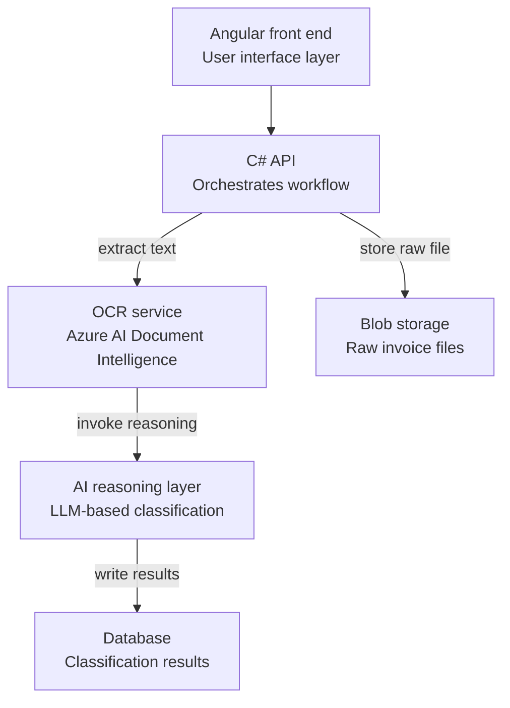

# CIS Invoice Classification Project - Requirements Draft

## Project Overview
Build a system, positioned as a PwC advisory/compliance tool, that ingests contractor and 
subcontractor invoices and automatically classifies spend as "construction operations" vs 
"services" under the UK Construction Industry Scheme (CIS), an HMRC tax-deduction scheme.

The key driver: firms moving into construction from adjacent sectors (e.g. asset management firms 
diversifying into property/construction) often don't realise CIS applies to them until it becomes 
a compliance problem. Rather than a purely internal invoice-processing tool, this is intended as 
something PwC can offer out to clients, an automated way to flag CIS exposure, classify spend, 
and produce an audit-ready reasoning trail, reducing the risk of clients missing deductions or 
falling foul of HMRC without realising it.

This reframes the goal from "support CIS compliance reporting" to "give clients (and PwC advisors) 
visibility into CIS exposure and automate the classification work needed to stay compliant."

## Background: What is CIS
The Construction Industry Scheme is an HMRC scheme requiring contractors to deduct tax from 
payments made to subcontractors for construction operations (excluding VAT and the cost of 
materials). Distinguishing "construction operations" from professional services, off-site 
manufacturing, or plant hire without an operator is central to correct classification.

## System Architecture Diagram

## Core Workflow
1. Invoices are dropped into a front-end folder (synthetic/AI-generated invoices used for testing 
   and demoing initially, since real client data may not be available)
2. User clicks a "process" button to trigger the pipeline
3. System reads invoices via OCR (Optical Character Recognition), likely Azure AI Document 
   Intelligence, since it's built for structured documents like invoices, to extract text and 
   line items from PDFs/scanned documents
4. Extracted data is parsed into structured fields (line item description, amount, supplier, date)
5. Each line item is passed to an LLM (e.g. GPT via Azure OpenAI Service) with contextual prompting 
   on CIS rules, to classify as construction vs services and generate a reasoning explanation
6. Classified data and reasoning trail are stored in a database
7. Raw invoice files stored in Azure Blob Storage
8. Results surfaced via API to the front end

## Architecture Components

### Backend / API
- Built in C#
- Acts as the intermediary between front end, storage, OCR, and the reasoning engine
- Key endpoints likely needed: process invoices, get all invoices, get invoice by ID, 
  get summary/aggregate stats
- Handles calls out to OCR and Azure OpenAI Service in sequence during processing

### OCR (Text Extraction)
- Separate step from the AI reasoning layer, OCR extracts raw text/structure, it doesn't 
  do any classification reasoning itself
- Likely candidate: Azure AI Document Intelligence (formerly Form Recognizer), since it's 
  purpose-built for structured documents like invoices and can extract fields (line items, 
  amounts, supplier) more reliably than generic OCR
- Runs before the AI reasoning layer in the pipeline, its output (clean structured text) 
  is what gets fed into the LLM for classification

### AI / Reasoning Layer
- Explicit client requirement: use an AI reasoning approach (LLM-based, e.g. GPT via Azure OpenAI), 
  NOT a trained/traditional machine learning model
- Rationale: avoids need for large labeled training datasets, more flexible to rule changes, and 
  produces explainable reasoning per classification decision (important for audit trail)
- Prompting strategy: line-item level classification, providing CIS definitions of construction 
  operations vs exclusions (professional services, off-site manufacturing, plant hire without 
  operator, etc.), asking for structured output (classification + reasoning) ideally as JSON

### Storage
- Database: stores processed invoice data, line-item classifications, reasoning text
- Azure Blob Storage: stores raw invoice files
- Azure chosen for consistency with Microsoft stack and likely data residency/compliance needs

### Front End
- Framework: Angular (Mark's preference, over React)
- Key views:
  - Grid/table view of all invoices
  - Summary tab: total invoice value vs. total construction spend (aggregate proportions)
  - Invoice detail view: click into a single invoice to see line-item level classification 
    and the AI's reasoning for each line

## Deliverables / Milestones
- Initial deliverable: either a video walkthrough demonstrating requirements and proposed 
  implementation, OR a written document covering the same, decide which format to lead with
- Presentation to the team: request approx. 1 hour slot, tentatively week commencing 17th or 24th
- Local deployment for initial demo (not necessarily cloud-hosted for MVP/demo stage)

## Communication Plan with Mark
- Batch up outstanding questions rather than sending them one at a time
- Confirm preferred initial deliverable format (video vs. written doc)

## Open Questions for Mark
2. What database technology does the firm standardise on (e.g. SQL Server, PostgreSQL, Cosmos DB)?
4. What level of audit trail / explainability is required for HMRC compliance purposes, does the 
   reasoning text need to be stored permanently and retrievable, or is it just for internal review?
5. Should classification happen at line-item level only, or does Mark also want invoice-level 
   overall classification (e.g. "mostly construction" vs "mostly services")?
6. Are there existing HMRC CIS classification guidelines/documents the firm uses internally that 
   should be baked into the prompting, beyond general public guidance?
9. Given the reframing toward a client-facing PwC tool, should this support multiple clients/tenants 
   from the outset (e.g. separate data per client, configurable per-client rules), or is a single-client 
   MVP fine for the initial demo with multi-tenancy considered later?

## Cost / Deployment Notes
- Azure for Students offer: if enrolled as a full-time student at an accredited institution, 
  verification via school email unlocks $100 in Azure credits (12 months, no credit card required), 
  including access to Azure OpenAI Service, likely sufficient to build and demo this prototype 
  (OCR, blob storage, GPT calls) at low/no cost
- Note: this offer is intended for educational/non-commercial use, so worth checking whether that's 
  appropriate given this is ultimately for a client/employer project, may be fine for a personal 
  proof-of-concept build, but flag if scaling beyond that
- Once credits are used up (or if not eligible), Azure OpenAI moves to standard pay-as-you-go pricing

## Suggestions for Getting Started
- Start with a small, clearly-defined proof of concept: OCR plus LLM classification on a handful 
  of synthetic invoices, without the full API/front-end build, to validate the reasoning approach works
- Build a prompt library / rules reference document from HMRC CIS guidance early, since prompt 
  quality will directly drive classification accuracy
- Mock up the front-end screens (grid, summary, drill-down) early using placeholder data to get 
  quick feedback on UX direction from Mark before backend is fully built
- Consider logging every AI classification decision with a timestamp and model version, useful 
  both for debugging and potentially for compliance/audit purposes down the line